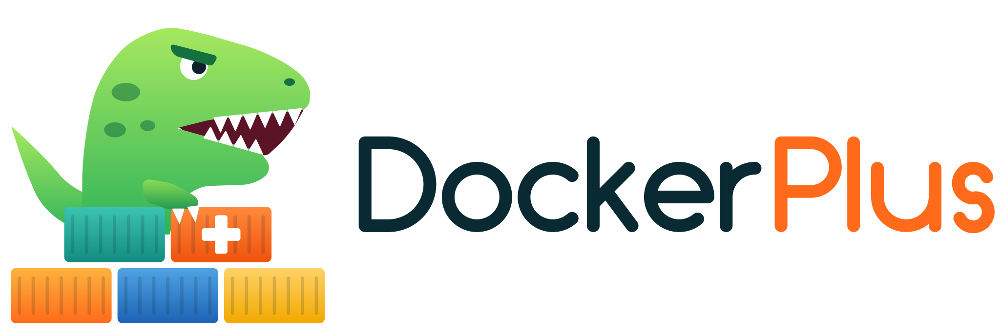
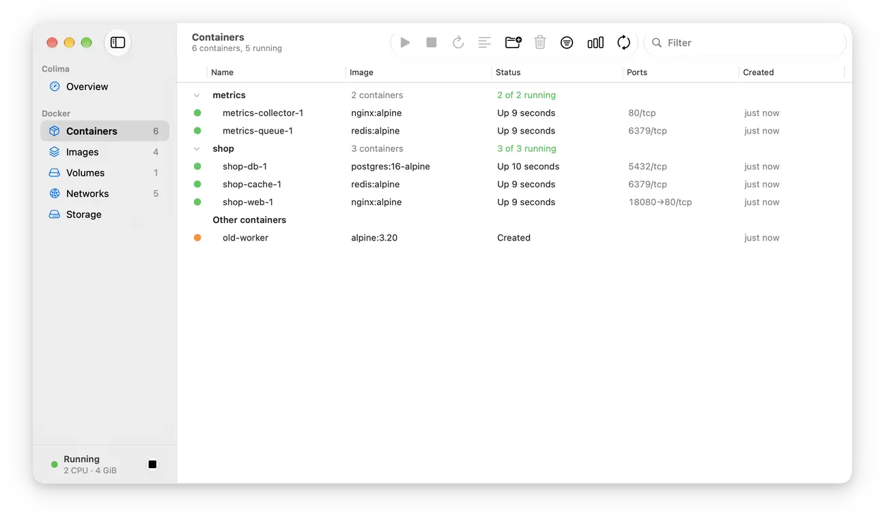

<p align="center">
  <picture>
    <source media="(prefers-color-scheme: dark)" srcset="assets/brand/rex/lockup-on-dark.svg">
    
  </picture>
</p>

<p align="center">
  A small, native Mac app for <a href="https://github.com/abiosoft/colima">Colima</a> and its Docker engine.<br>
  Rust on AppKit with real Liquid Glass. No webview, no background runtime.
</p>

<p align="center">
  <picture>
    <source media="(prefers-color-scheme: dark)" srcset="assets/screenshots/tour-dark.webp">
    
  </picture>
</p>

<p align="center"><b>1.6 MB</b> app &nbsp;·&nbsp; about <b>50 MB</b> of memory &nbsp;·&nbsp; near <b>0%</b> CPU when idle</p>

## What it does

- **Containers:** start, stop, restart, pause, remove. Right-click to open a shell, a port or a mount.
- **Compose:** projects group in the list, fold shut, and start, stop, restart or remove as one.
- **Logs:** live, with search. Stays responsive when a container floods them.
- **CPU and memory:** only when you ask, and never in the background.
- **Images, volumes, storage:** pull images, see sizes and what uses what, and remove what
  nothing needs.
- **Colima:** start, stop, restart, and change CPUs, memory and disk.

`⌘1`–`⌘5` pages · `⌘F` filter · `⌘L` logs · `⇧⌘F` find in logs · `⌘I` details · `⇧⌘M` CPU and memory · `⌘R` refresh

## Install

Needs macOS 26 or later, [Homebrew](https://brew.sh) and the Xcode Command Line Tools.

```bash
git clone https://github.com/dockerplus/dockerplus
cd dockerplus
scripts/install.sh
```

This installs what is missing, builds the app from source into `/Applications` and adds the
`dockerplus` command. A full build takes about 30 seconds on an M1 Pro once Rust is in place.
Run it again to update.

There is no signed download yet. The app is ad-hoc signed, so it is meant for the Mac that
built it. The first Colima start downloads and sets up its VM, so it takes longer than later
ones.

## Next to Docker Desktop and OrbStack

DockerPlus talks only to Colima's socket and never changes your current Docker context.
Plain `docker` keeps working as before.

## Command line

`dockerplus` is the Docker CLI pointed at Colima.

```bash
dockerplus compose up -d    # runs on Colima
docker compose up -d        # runs on your current context
```

The two engines stay separate:

- Volumes and images are not shared, so a project starts empty on Colima.
- Colima shares only your home folder. Bind mounts from elsewhere come up empty.
- Only one engine can publish a port. If it is taken, Docker still says running, but the port
  cannot be reached.

`dockerplus` warns about the bind mounts it can see, and refuses `context`, `--context` and
`--host`, which would leave Colima.

## Good to know

- Closing the window quits the app. Colima keeps running.
- Remove asks first, and only a click confirms it. Return does nothing, Esc cancels.
- Removing unused data frees space inside the VM. Its disk file on the Mac does not shrink.
- If your macOS user name is also an Ubuntu system account (`man`, `mail`…), DockerPlus writes
  `~/.colima/_lima/_config/override.yaml` so `colima start` does not hang.

## Development

```bash
cargo test
scripts/bundle.sh --features devtools   # adds a socket that drives the UI in tests
```

`src/backend/` holds the Docker API and Colima CLI code, `src/ui/` the AppKit views.
Brand guide: [assets/brand/rex/BRAND.md](assets/brand/rex/BRAND.md).

Version 0.1, tested on an M1 Pro MacBook Pro with macOS 27.2, Colima 0.10.3 and Docker Engine
29.5.2, where the memory and idle CPU above were measured. Not yet supported: Colima profiles
other than `default`, Compose up, networks, notarization.

## License

MIT. See [LICENSE](LICENSE).

Docker is a trademark of Docker, Inc. DockerPlus is an independent project and is not
affiliated with or endorsed by Docker, Inc.
