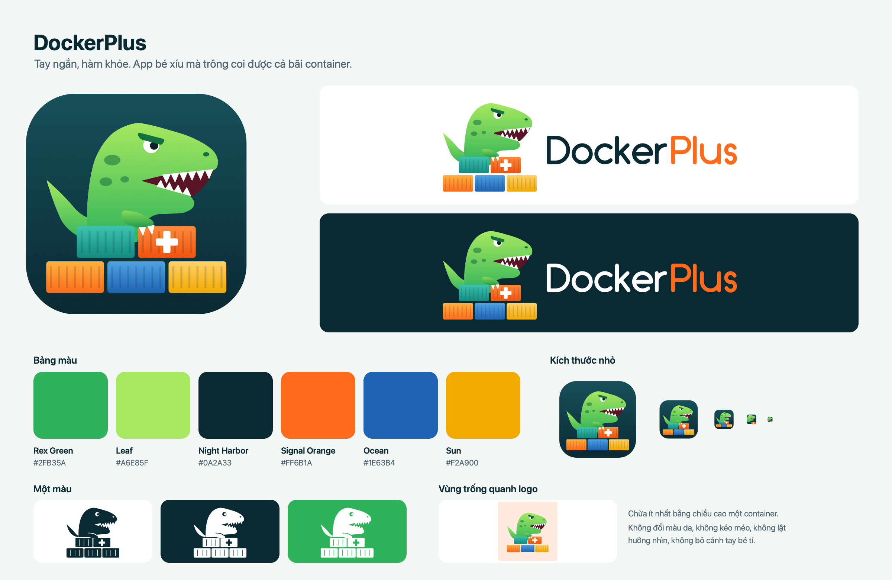

# DockerPlus



A native macOS app for [Colima](https://github.com/abiosoft/colima) and its Docker
engine. Written in Rust on AppKit, with real Liquid Glass. No webview, no background
runtime.

Requires macOS 26 or later.

## Features

- **Colima:** VM status and settings; start, stop and restart with live output.
- **Containers:** list, start, stop, restart, remove; follow logs.
- **Images:** list by tag, pull, remove.
- **Volumes:** list with size and the containers using them; remove.
- Filter, sort and multi-select in every table, with a context menu.
- Updates live from Docker events.

Shortcuts: `⌘1`–`⌘4` switch pages, `⌘F` filter, `⌘L` logs, `⌘R` refresh.

Closing the window quits the app. Colima keeps running.

## Build and run

You need Rust, the Xcode Command Line Tools and Colima (`brew install colima`).

```bash
scripts/bundle.sh
open target/DockerPlus.app
```

To install, copy `target/DockerPlus.app` to `/Applications`. The app is ad-hoc signed
and not notarized, so it is meant for the machine that built it.

Run the tests with `cargo test`.

## Other Docker installs are left alone

- DockerPlus talks only to Colima's socket (`~/.colima/default/docker.sock`) and never
  reads `docker context`, so Docker Desktop and OrbStack are out of reach.
- It always starts Colima with `--activate=false`, so your active Docker context does
  not change. Colima saves this as `autoActivate: false` in
  `~/.colima/default/colima.yaml`, which also applies when you run `colima start` by
  hand. To make Colima the default, run `docker context use colima`.

## macOS user names that clash with Ubuntu

If your macOS user name is also a system account in Ubuntu (`man`, `mail`, `games`…),
`colima start` hangs for about 10 minutes and then fails with `did not receive an
event with the running status`. Before starting Colima, DockerPlus writes
`~/.colima/_lima/_config/override.yaml` so the VM user is `colima`. It never
overwrites an existing file.

## Project layout

```text
src/backend/   Docker Engine API over a Unix socket and the colima CLI; no AppKit, unit-tested
src/ui/        AppKit views via objc2; main thread only
src/rex.rs     T-rex mascot geometry, shared by the icon, SVGs and in-app glyphs
src/mark.rs    Path helpers and the earlier truck logo
examples/      make_brand regenerates the brand assets
```

Brand guide: [assets/brand/rex/BRAND.md](assets/brand/rex/BRAND.md).

## UI testing

A build with `--features devtools` opens a control socket that drives the real UI
(`state`, `page containers`, `do ContainerStop`, `snapshot <path>`, …). Default builds
do not include it.

```bash
scripts/bundle.sh --features devtools
open --env DOCKERPLUS_DEV_SOCK="$PWD/target/dp.sock" target/DockerPlus.app
```

## Status

Version 0.1, tested on an M1 Pro MacBook Pro with macOS 27.2, Colima 0.10.3 and Docker
Engine 29.5.2.

- Not tested yet: physical mouse and keyboard input (tests go through the dev socket),
  macOS 26.x, Reduce Transparency and Increase Contrast.
- Not supported yet: Colima profiles other than `default`, changing CPU, memory or
  disk, Compose, networks, per-container stats, opening a shell, signing and
  notarization.
- Known issue: a container that floods its logs pushes CPU to about 90% while the log
  panel is open.
